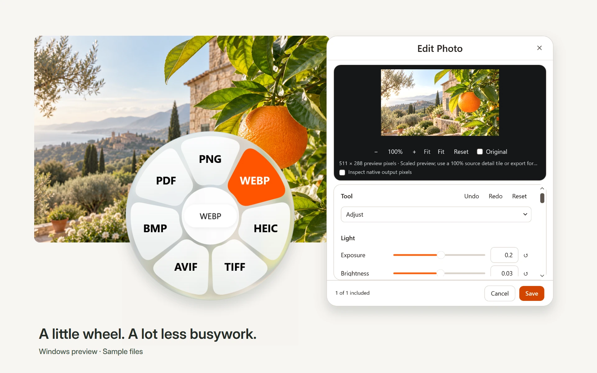
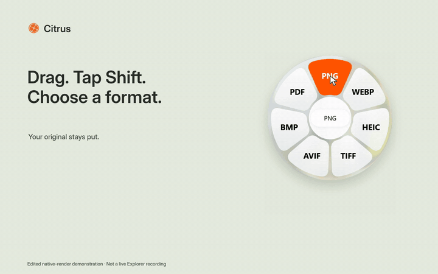
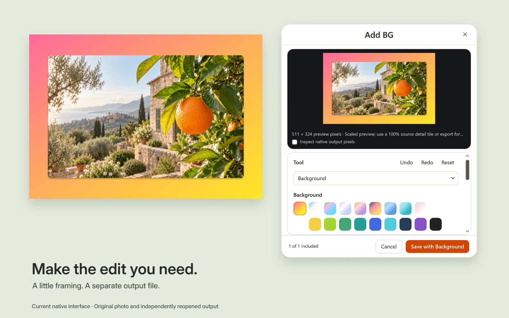
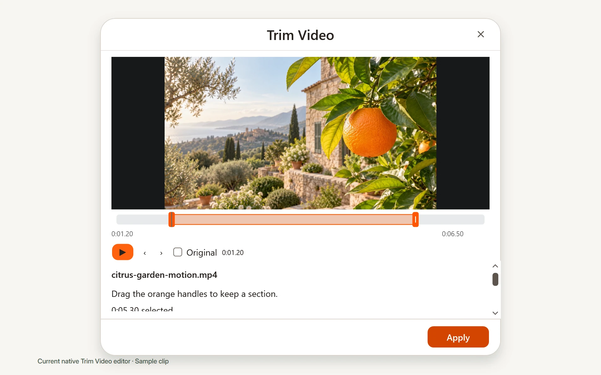

<h1 align="center">Citrus for Windows</h1>

<strong>Convert files. Keep your flow.</strong>

A compact wheel and focused editors for the file you are already working with. Images, video, audio, PDFs, documents and archives. Processed locally. Originals preserved.

<a href="https://github.com/Skytuhua/Citrus/releases"><strong>Download the Windows preview →</strong></a> &nbsp; · &nbsp; <a href="https://citrous.app/#product-demo">Watch the walkthrough</a> &nbsp; · &nbsp; <a href="https://citrous.app">Explore the website</a>

Windows x64 · 0.3.0-preview.2 · Open-source application

## The next useful thing, close to your file

Drag a local file and tap **Shift** to convert, **Alt** for tools or **Ctrl** for file actions. Pick a destination on the wheel, then drop. You can also add files in the workspace and choose a task there.

The wheel stays compact. Menus use clear white surfaces. Photo adjustments, crop handles, video playback and audio waveforms give each task the controls it needs.

*Edited product demonstration using sample files and exports of the actual Citrus interface. Composited wheel sequences are not a real-time Explorer recording or a performance benchmark. [Watch the 10-second launch film](https://citrous.app/assets/launch-v1/citrus-launch-10s.mp4).*

## A useful set of tools

| Your file | What you can do |
|---|---|
| **Images** | Convert PNG, JPEG, WebP, HEIC, TIFF, AVIF, BMP and more. Adjust light and color, crop, annotate, redact, add a background, compress or edit metadata. |
| **Video** | Convert formats; play and scrub the real picture. Trim with handles, crop directly, change speed, mute, redact, take a snapshot or split a clip. |
| **Audio** | Convert, trim, normalize, adjust channels, add bleep ranges, visualize, compress and edit metadata. Audition the edited result. |
| **PDFs** | Organize pages with thumbnails, reorder, rotate, duplicate, split or merge. Export text, images and reconstructed editable documents, with OCR for supported scans. |
| **Documents & books** | Offline document, presentation, spreadsheet and EPUB conversions. Pages destinations produce clearly labeled, Pages-compatible DOCX files. |
| **Archives & subtitles** | Create or repack archives, extract supported archives, and convert SRT/VTT or readable text. |

Format and codec support depends on the actual file. PDF reconstruction and document layout are best effort. See the [complete capability table](docs/operations.md) and [preview limitations](docs/PREVIEW-NOTES.md).

### Make a small edit without losing the original

Adjust the photograph, compare the original and save a separate result. Add a background, padding and rounded corners when the image needs a little more room.

See the video while you work. Drag trim or crop handles, scrub to a moment, and step through exact source frames. Advanced controls stay out of the way until needed.

## Download and start

1. Get **Citrus-Setup.exe** from [GitHub releases](https://github.com/Skytuhua/Citrus/releases), or use the [download page](https://citrous.app/download/).
2. Check its published SHA-256 and release notes. This preview is **unsigned**; Windows may report an unknown publisher. Make your own trust decision before running it.
3. Install for your Windows user, open Citrus and add a local file. Choose a format or tool and review the separate output.

The installer includes the runtime and offline engine pack; its download is substantial. See the download page for the measured size and requirements. Closing the launcher keeps the tray app running; choose **Quit** from the tray to exit fully.

Installed releases check for updates in the background. Verified updates install when Citrus is idle, with no edits or conversions interrupted. Version 0.3.0-preview.1 needs one manual upgrade to acquire this updater. [Automatic updates and controls](docs/AUTOMATIC-UPDATES.md).

**Windows x64 only.** Windows 11 is recommended; the application's technical minimum is Windows 10 build 19041. No macOS, Linux or native ARM64 installer is provided. [Quick start and uninstall help](docs/QUICKSTART.md).

## Made for your files

- **Local processing.** Conversions and edits run on your computer, without an upload workflow or an account.
- **Separate outputs.** Conversion and editing jobs preserve original bytes and location. Moving originals is a separate, explicit action.
- **Deliberate interaction.** Scroll for wheel pages; gaps retain the last selection. The neutral center, Escape or right-click cancels.
- **Readable controls.** Compact white menus, centered titles and right-side close buttons. Glass is limited to the wheel backing and page control.

## A preview, with clear limits

This is an actively developed preview. It is not a claim of universal format fidelity, zero delay or completed testing on every Windows configuration. Opening-time targets and full Explorer/mixed-DPI acceptance remain open. The workspace's static video thumbnail is limited; the actual video editors show playable video.

Current verification includes 604 backend passes across two disjoint batches, 234 core passes and a 52-pass final compact-video UI batch. Those are bounded checks, not acceptance of every native workflow. See [preview notes](docs/PREVIEW-NOTES.md) and the [changelog](CHANGELOG.md).

## Help make Citrus better

[Report a bug](https://github.com/Skytuhua/Citrus/issues/new/choose) · [Support](SUPPORT.md) · [Contribute](CONTRIBUTING.md) · [Build from source](docs/DEVELOPMENT.md) · [Security](SECURITY.md)

Please use a non-sensitive sample when reporting a file issue. Never attach private documents, credentials or unredacted desktop captures.

## License and credits

Citrus application code is available under the [MIT License](LICENSE). Bundled engines, fonts and Windows components retain their own licenses and terms; see [third-party notices](THIRD-PARTY-NOTICES.md), the installer's component notice and the sources included with the engine pack.

The native wheel material adapts Liquid Glass Studio's optical work with attribution. Launch photography is original AI-generated sample content; product UI is rendered from the app. [Media provenance](docs/launch/2026-10-21/media/README.md).
